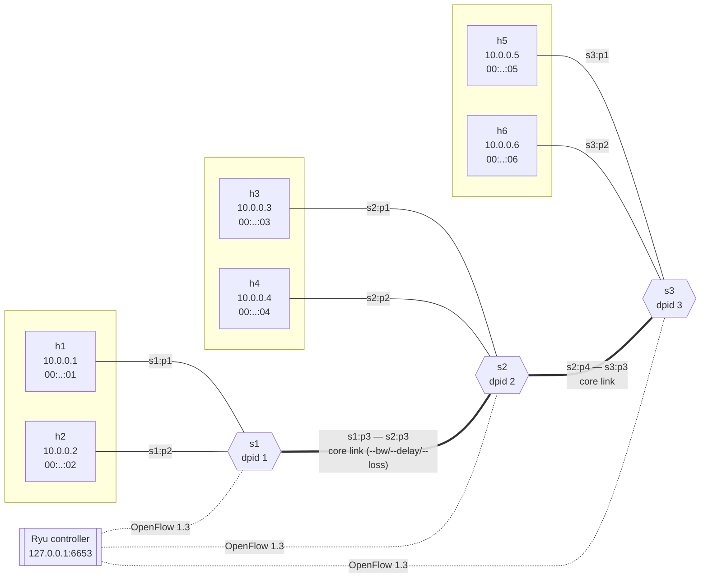
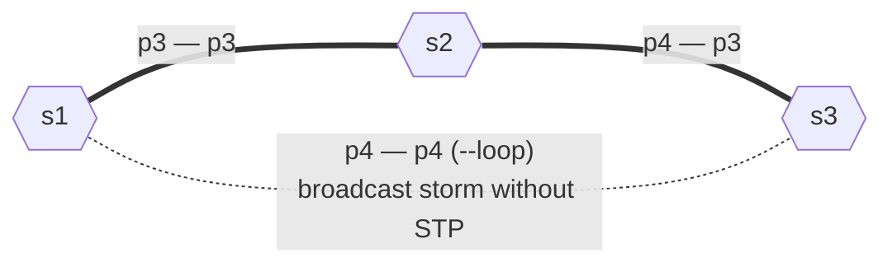
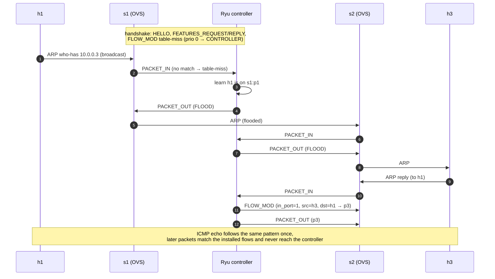

# Lab 1 — Topology diagrams

Referenced by `lab_topo.py`, `hub_13.py`, `learning_switch_13.py` and `Lab01-Mininet-Ryu.md`.
These diagrams render on GitHub/GitLab, in VS Code (Markdown Preview Mermaid Support) and in Obsidian.

## Lab 1 - topology

Three OpenFlow 1.3 switches in a line, two hosts per switch, one remote Ryu controller.
Edge labels give the **OpenFlow port number on the switch side** (fixed in `lab_topo.py`).

## Lab 1 - loop variant

`sudo python3 lab_topo.py --loop` adds a direct s1–s3 link (port 4 on both), creating a physical loop (Part F).

## Lab 1 - reactive flow setup

What happens on the wire for the **first** packet of `h1 ping h3` with a learning switch (Part C).

