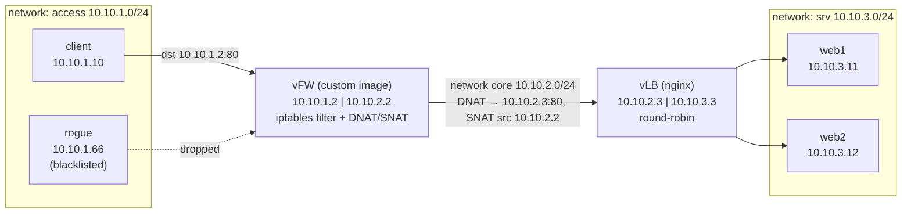
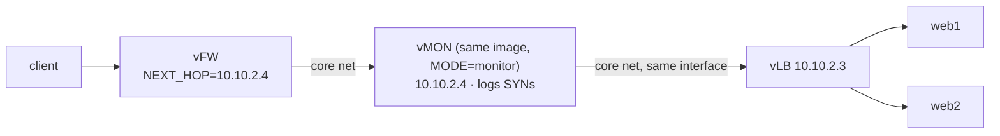
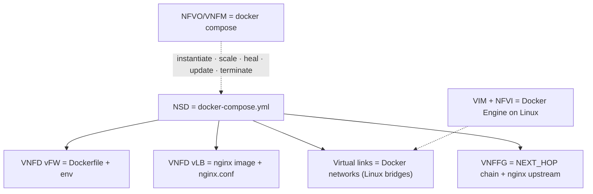

# Lab 3 — Topology diagrams

Referenced by `docker-compose.yml`, `docker-compose.vmon.yml`, `vnf-fw/entrypoint.sh`,
`vnf-lb/nginx.conf`, `measure.sh` and `Lab03-Docker-VNFs-SFC.md`.

## Lab 3 - service chain

Three Docker networks (each a Linux bridge) and the containers attached to them.
The client only knows the vFW service IP `10.10.1.2`.

## Lab 3 - chain with vMON

After `docker compose -f docker-compose.yml -f docker-compose.vmon.yml up -d` (Part D):
the vFW's `NEXT_HOP` points to the one-armed monitor, which NATs on to the vLB.

## Lab 3 - ETSI mapping

## Appendix — Abbreviations

| Abbreviation | Meaning | Function in this lab |
|---|---|---|
| DNAT | Destination Network Address Translation | Rewrites a packet's destination address so the vFW can direct client traffic to the vLB. |
| ETSI | European Telecommunications Standards Institute | Provides the NFV terminology and architecture used to map the Docker-based lab components. |
| IP | Internet Protocol | Provides the addressing used to route packets between hosts, network interfaces, and services. |
| MANO | Management and Orchestration | Covers the lifecycle management and orchestration of network services and their virtual functions. In this lab, Docker Compose acts as a simple stand-in. |
| NAT | Network Address Translation | Translates packet addresses; the vFW uses destination and source translation to steer traffic and manage its return path. |
| NFVI | Network Functions Virtualisation Infrastructure | Supplies the compute, networking, and other infrastructure on which virtual network functions run; here, this is represented by Docker Engine on Linux. |
| NFVO | Network Functions Virtualisation Orchestrator | Coordinates the deployment and lifecycle of a network service; Docker Compose represents this role in the lab. |
| NSD | Network Service Descriptor | Describes a network service and the functions and links it needs; `docker-compose.yml` serves as the lab's simplified representation. |
| SNAT | Source Network Address Translation | Rewrites a packet's source address; the vFW uses it so return traffic from the vLB follows the intended path. |
| SYN | Synchronize; the TCP flag used to initiate a connection | Marks the start of a TCP connection. The vMON observes/logs these packets in the monitoring variant. |
| TCP | Transmission Control Protocol | Provides reliable, connection-oriented transport for client-to-service connections. |
| VIM | Virtualised Infrastructure Manager | Manages the virtualised infrastructure resources; Docker Engine on Linux is the lab's simplified stand-in. |
| vFW | Virtual firewall | Applies firewall filtering and address translation between the client-facing and core networks. |
| vLB | Virtual load balancer | Distributes incoming requests across the web servers, using nginx in this lab. |
| VL | Virtual link | Connects virtual network functions; Docker networks (Linux bridges) provide the links in this lab. |
| VNF | Virtual Network Function | A software implementation of a network function; the vFW, vLB, and vMON are the lab's examples. |
| VNFD | Virtual Network Function Descriptor | Describes a VNF's software and configuration; a Dockerfile and environment settings are used as a simplified representation. |
| VNFFG | Virtual Network Function Forwarding Graph | Specifies how traffic passes through VNFs; the `NEXT_HOP` chain and nginx upstream represent the service path here. |
| VNFM | Virtual Network Function Manager | Manages an individual VNF's lifecycle; Docker Compose stands in for this role in the lab. |
| vMON | Virtual monitor | Observes traffic (in this lab, logs TCP SYN packets) while forwarding traffic toward the vLB. |
