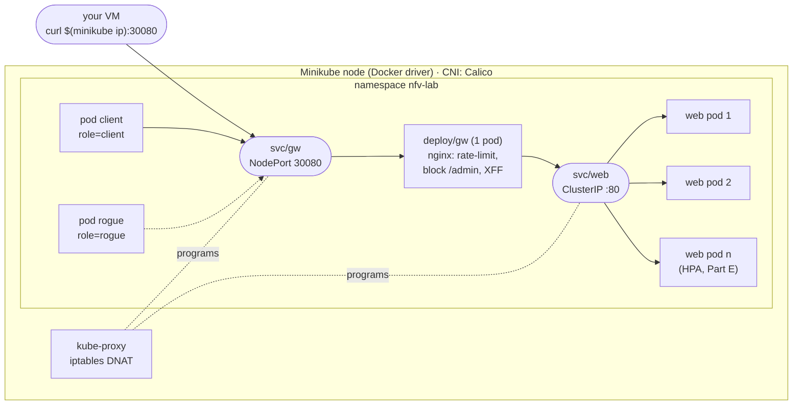
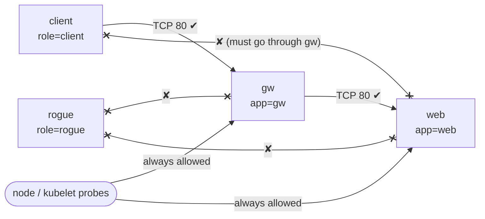
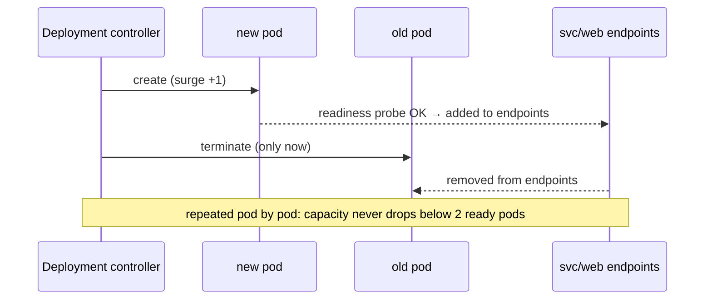

# Lab 4 — Topology diagrams

Referenced by every file in `manifests/`, `probe.sh`, `check_policy.sh` and `Lab04-Minikube-CNF.md`.

## Lab 4 - CNF service

One Minikube node. Namespace `nfv-lab`. Kubernetes Services do the load balancing that the vLB
container did in Lab 3; the gateway CNF plays the role of the vFW.

## Lab 4 - allowed flows after NetworkPolicy

After `40-netpol-default-deny.yaml` + `41-netpol-chain.yaml` (Part D). Solid = allowed, crossed = denied.

## Lab 4 - rolling update

What `kubectl rollout restart deploy/web` does with `maxSurge: 1, maxUnavailable: 0` and a readiness probe (Part C).

